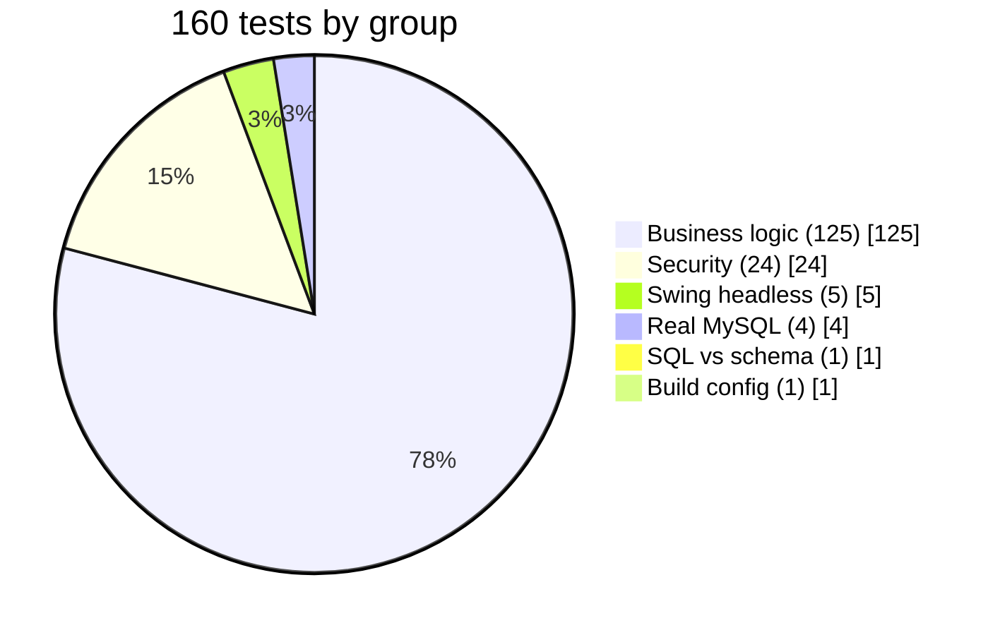
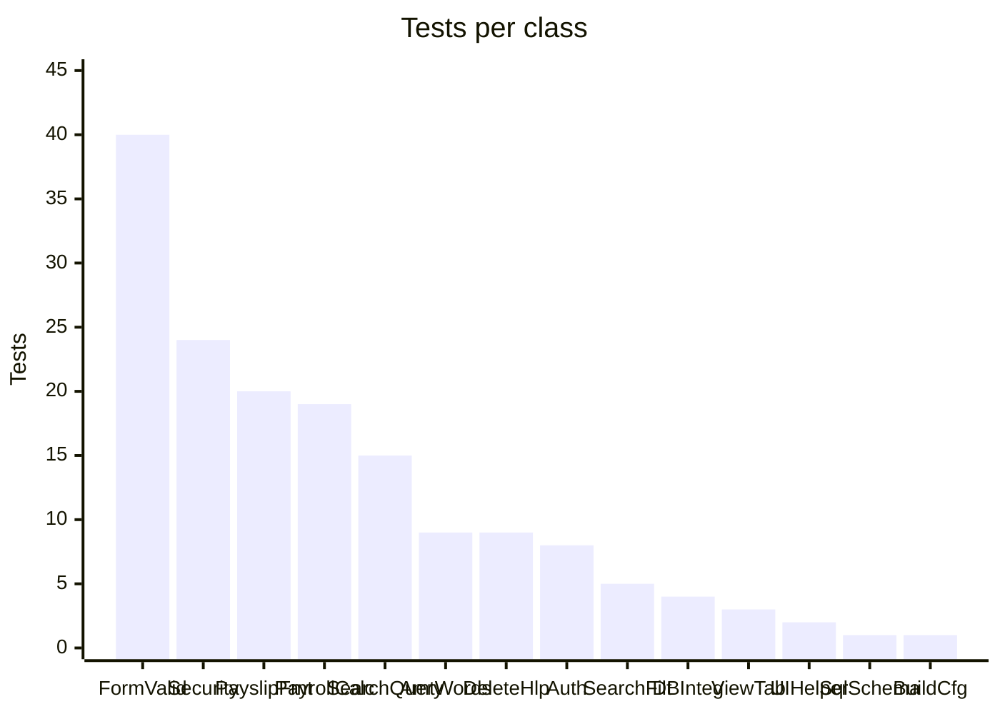
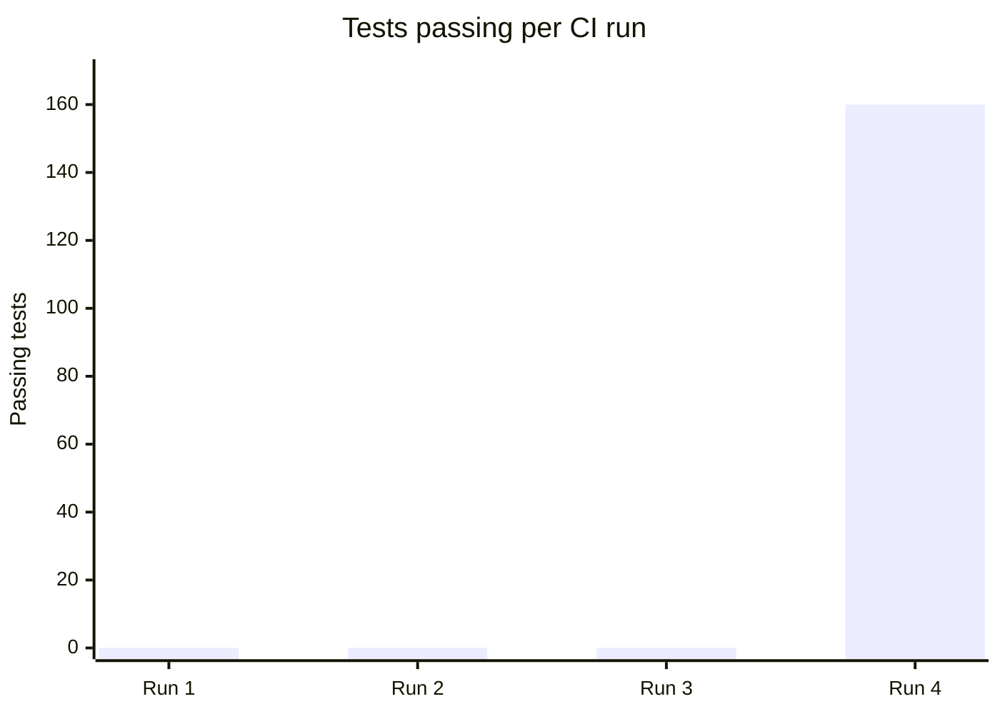
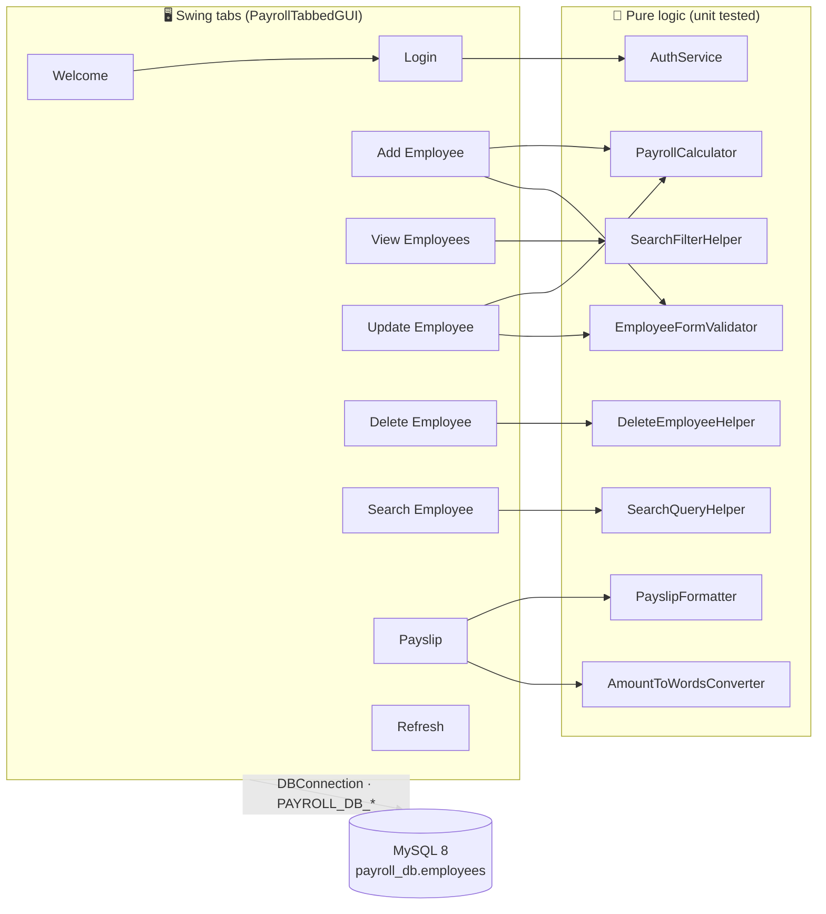
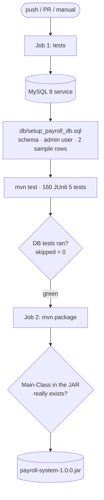
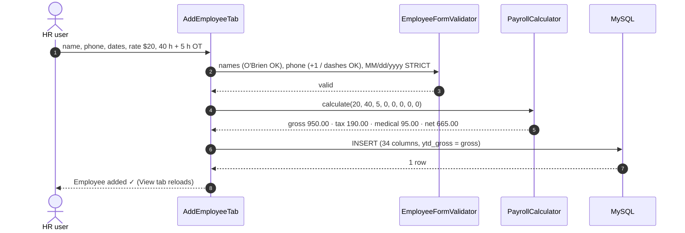
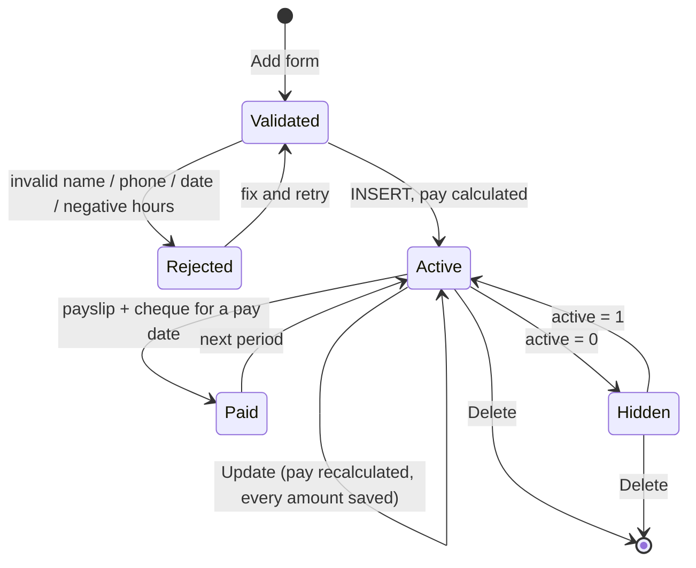
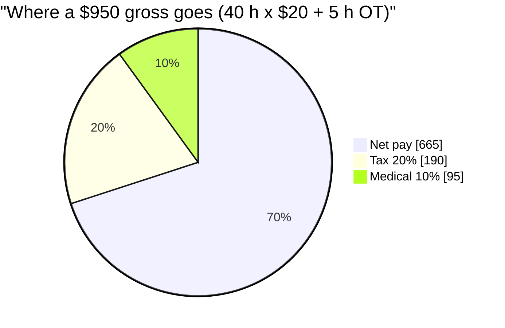
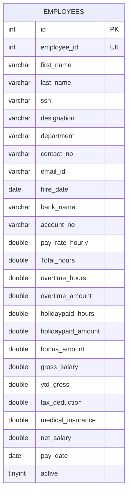

<div align="center">

# 💼 Payroll Management System — Java Swing · MySQL · JDBC

### A desktop payroll application: employees, a pay engine with overtime / double-time / holiday pay, payslips and cheques. It is built, tested against a real MySQL database and packaged as a runnable JAR on every push.

[](https://git.io/typing-svg)

<!-- ============ STATUS BAR ============ -->
[](https://github.com/rbchy/PayrollManagementSystem/actions/workflows/ci.yml)


</div>

---

## 📌 At a Glance

<table>
<tr>
<td width="50%" valign="top">

**🙋 What this is**

The **application repository** of the Payroll Management System: a Java Swing desktop app on MySQL for small-business payroll.

- employee records: add, view, update, search, delete
- a **pay engine**: normal pay (first 40 h), overtime ×1.5, double time ×2, extended / holiday / special-work hours, bonus, 20 % tax, 10 % medical
- **payslip and cheque** for an employee and pay date, with the amount in words

The full test-automation suite for the same app lives in the companion repo **[PayrollManagementSystems_Automation_Java_MySql_Selenium](https://github.com/rbchy/PayrollManagementSystems_Automation_Java_MySql_Selenium)**: 260 tests, including Cucumber BDD and AssertJ-Swing UI robots. This repo keeps the app with a focused regression suite of **160 JUnit tests**.

</td>
<td width="50%" valign="top">

**📍 Quick facts**

| | |
|---|---|
| 🖥️ **App** | Java 21 Swing, 9 tabs |
| 🗄️ **Database** | MySQL 8, `payroll_db.employees` (35 columns) |
| 🧪 **Tests** | 160 JUnit 5 tests · ≈ 14 s |
| 🗃️ **DB tests** | Add / Update / Search / View / Payslip / Delete on real MySQL |
| 📦 **Output** | `payroll-system-1.0.0.jar` (fat JAR) |
| 🔁 **Runs** | push · pull request · manual |
| 🔐 **DB settings** | `PAYROLL_DB_URL` / `_USER` / `_PASSWORD` |

</td>
</tr>
</table>

---

## ✅ Latest Results (GitHub Actions)

| Group | Classes | Tests | ✅ Passed |
|---|---|---:|---:|
| 🧩 Business logic | `PayrollCalculator` · `AmountToWordsConverter` · `PayslipFormatter` · `EmployeeFormValidator` · `AuthService` · `SearchQueryHelper` · `SearchFilterHelper` · `DeleteEmployeeHelper` | 125 | 125 |
| 🛡️ Security | `SecurityTest` (SQL-injection inputs, bad regex) | 24 | 24 |
| 🖥️ Swing (headless) | `UIHelperTest`, `ViewEmployeeTabTest` | 5 | 5 |
| 📐 SQL ↔ schema | `SqlSchemaConsistencyTest` (scans every SQL string) | 1 | 1 |
| 📦 Build | `BuildConfigTest` (JAR main class exists) | 1 | 1 |
| 🗄️ Real MySQL | `EmployeeSqlIntegrationTest` | 4 | 4 |
| **Total** | **15 classes** | **160** | **160** |





### Red first, then green

The two new regression tests went in **before** the fixes, and CI was red for exactly the bugs they target:

| CI run | What happened |
|---|---|
| 1 | ❌ **compile error**: `PayrollTabbedGUI.java` also defined `ViewEmployeeTab`, `DeleteEmployeeTab`, `WelcomeTab`, `LoginTab`, `RefreshTab` (duplicate classes) |
| 2 | ❌ compile error: `new RefreshTab(viewTab)`, but the real constructor needs the View **and** Update tabs |
| 3 | ❌ 2 / 2 tests failed: `bankname, accountno, holiday_paid_hours, special_work_hours` are not columns; JAR main class `PayrollSystem_V14_DB_Full` does not exist |
| 4 | ✅ 160 / 160 after the fixes; JAR manifest verified |



---

## 🏗️ Architecture



### CI pipeline



### Add an employee



### Employee record lifecycle



---

## 💰 Payroll Rules

| Component | Formula |
|---|---|
| Normal pay | `min(totalHours, 40) × rate` |
| Overtime | `overtimeHours × rate × 1.5` |
| Double time | `doubletimeHours × rate × 2` |
| Extended / Holiday / Special work | `hours × rate` |
| **Gross** | sum of the above + bonus |
| Tax | `gross × 20 %` |
| Medical | `gross × 10 %` |
| **Net** | `gross − tax − medical` |



Negative rates, hours or bonuses are rejected. Money is rounded half-up to cents. The cheque line reads `SIX HUNDRED SIXTY FIVE AND 00/100`.

---

## 🗄️ Database

The schema the code actually uses is in [`db/setup_payroll_db.sql`](db/setup_payroll_db.sql). One `employees` table holds the profile, hours, amounts and the last pay date.



<sub>Simplified: the table also has doubletime, extended and special-work hours/amounts, `customer`, `salary` and `total_deductions`.</sub>

---

## ▶️ Running Locally

**Prerequisites:** JDK 21, Maven 3.9+, MySQL 8.

```bash
# 1. Database: payroll_db, user admin/admin123 (local demo only), 2 sample employees
mysql -u root -p < db/setup_payroll_db.sql

# 2. Tests (DB tests skip if MySQL is not reachable)
mvn test

# 3. Build and run
mvn -DskipTests package
java -jar target/payroll-system-1.0.0.jar      # demo login: admin / admin123
```

| Setting | Env var | `-D` property | Default |
|---|---|---|---|
| JDBC URL | `PAYROLL_DB_URL` | `payroll.db.url` | `jdbc:mysql://localhost:3306/payroll_db` |
| DB user | `PAYROLL_DB_USER` | `payroll.db.user` | `admin` |
| DB password | `PAYROLL_DB_PASSWORD` | `payroll.db.password` | `admin123` |

---

## 📁 Project Structure

```text
PayrollManagementSystem/
├── .github/workflows/ci.yml        # MySQL service + JUnit, fat-JAR job
├── db/setup_payroll_db.sql         # schema, app user, sample rows
├── pom.xml                         # Java 21 · Connector/J · JUnit 5 · shade
└── src/
    ├── main/java/com/payroll/
    │   ├── PayrollTabbedGUI.java   # main window (JAR entry point)
    │   ├── *Tab.java               # Welcome, Login, Add, View, Update, Delete, Search, Payslip, Refresh
    │   ├── PayrollCalculator.java  # pay engine
    │   ├── AmountToWordsConverter.java · PayslipFormatter.java
    │   ├── EmployeeFormValidator.java · AuthService.java
    │   ├── SearchQueryHelper.java · SearchFilterHelper.java · DeleteEmployeeHelper.java
    │   └── DBConnection.java
    └── test/java/com/payroll/      # 15 JUnit 5 classes
```

---

## 🧹 Maintenance Log

| Area | Before | Now |
|---|---|---|
| **Build** | **did not compile**: 5 tab classes defined twice; `RefreshTab` called with the wrong arguments | compiles; CI builds every push |
| **Runnable JAR** | manifest pointed at `PayrollSystem_V14_DB_Full`, which does not exist | `com.payroll.PayrollTabbedGUI`; CI checks the manifest |
| **Update Employee** | SQL used 4 non-existent columns → every update failed; gross / net never saved | correct columns, all amounts saved; proven on real MySQL |
| Pay maths | Add and Update used different formulas (no 40 h cap, extended ×1.5, special work without the rate) | one `PayrollCalculator` for both |
| Cheque | words lost a space, billions dropped, cents in words | `… AND 50/100`, singular "One Dollar" |
| Dates | `11/31/2025` silently became `11/30/2025` | rejected (STRICT parsing) |
| Validation | `O'Brien`, `Anne-Marie`, `+1 555-0100` rejected | accepted; negative hours rejected |
| Live search | typing `(` or `*` threw `PatternSyntaxException` | safe filter |
| YTD gross | always 0 | starts at the first period's gross |
| Database | README showed an `Employee(emp_id, emp_name…)` + `Attendance` schema the code never used | real schema in `db/setup_payroll_db.sql` |
| Repo | `target/`, `.classpath`, `.project` committed | removed; `.gitignore` |
| README | described HRA / DA / PF, attendance tracking and sign-up, none of which exist | rewritten from the code and the CI run |

---

## 📈 Roadmap

- [x] Compiles, tested and packaged in CI
- [x] Update Employee works against the real schema
- [ ] `payroll_history` table so YTD gross is a real yearly sum
- [ ] Hash the login password instead of a fixed demo pair
- [ ] PDF payslips (iText 7 is already a dependency)
- [ ] Excel payroll report (Apache POI is already a dependency)

---

## 🔗 Related Projects

| Repo | What it is |
|---|---|
| [PayrollManagementSystems_Automation_Java_MySql_Selenium](https://github.com/rbchy/PayrollManagementSystems_Automation_Java_MySql_Selenium) | Same app with the full 260-test suite: Cucumber BDD, AssertJ-Swing UI robots, MySQL |
| [InventoryControlManagement_JavaMySql](https://github.com/rbchy/InventoryControlManagement_JavaMySql) | Java Swing + MySQL inventory app with CI |
| [BhojanAloy-Food-Coffee-Shop-POS-System](https://github.com/rbchy/BhojanAloy-Food-Coffee-Shop-POS-System) | Java POS system with MySQL |
| [rbchy](https://github.com/rbchy/rbchy) | Profile and full project list |

---

## ⚠️ Disclaimer

Educational / portfolio project. Tax and insurance rates are fixed demo values, not real payroll law. `admin / admin123` are local demo credentials only.

---

## 👤 Author

<div align="center">

**Ranajit Baran Chowdhury (RB Chowdhury)**
Software Programmer & QA Automation Engineer · West Norriton, Pennsylvania, USA

[](https://www.linkedin.com/in/rbchy/)
[](https://github.com/rbchy)
[](https://rbchy.github.io/rbchy/)
[](https://rbc6543.wixsite.com/rbc-portfolio)
[](mailto:chyranajit@gmail.com)

⭐ *If this project helps you, a star on the repo is appreciated.*

</div>
